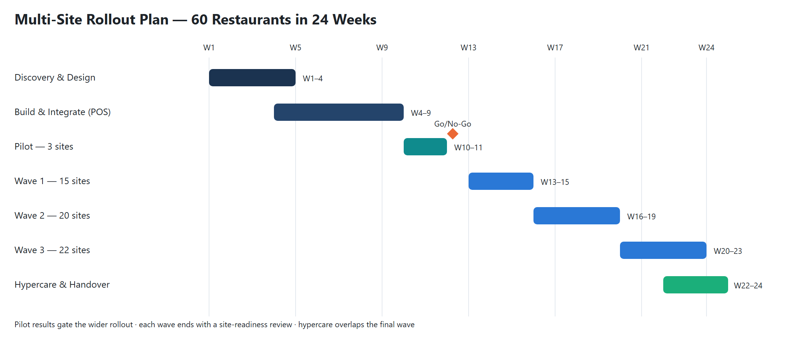

# 02 · Rollout Plan

## Rollout Strategy
A **pilot followed by three waves**. The pilot proves the integration and go-live process on a small, varied set of sites. Each wave then reuses the same checklist, team and communication pack.

| Phase | Sites | Weeks | Purpose |
|-------|:-----:|:-----:|---------|
| Discovery & Design | — | 1–4 | Data mapping, site audit, dashboard design |
| Build & Integrate | — | 4–9 | POS connector, data platform, dashboards |
| **Pilot** | 3 | 10–11 | Prove the process; Go/No-Go decision |
| **Wave 1** | 15 | 13–15 | Same POS version, single region |
| **Wave 2** | 20 | 16–19 | Mixed regions |
| **Wave 3** | 22 | 20–23 | Remaining sites, including complex ones |
| Hypercare | all | 22–24 | Stabilise, fix issues, hand over |

## Pilot Site Selection
The three pilot sites were chosen to represent the estate, not the easiest cases:
- **High-volume city-centre site:** tests data volume and peak trading.
- **Suburban family site:** tests a typical mid-volume restaurant.
- **Site on an older POS version:** tests the hardest integration.

## Wave Design Rules
- No go-lives on **Fridays, weekends or bank holidays**.
- No more than **6 sites per day**, so the support team is never overloaded.
- Group sites by **region** so area managers can support their own teams.
- Each wave starts only after the previous wave's **readiness review** is passed.

## Go/No-Go Criteria (end of pilot)
| Criterion | Threshold |
|-----------|-----------|
| Data accuracy vs. POS end-of-day report | ≥ 99.5% |
| Daily data available by 9am | 10 out of 10 days |
| Critical issues open | 0 |
| Site manager feedback | ≥ 4 / 5 |
